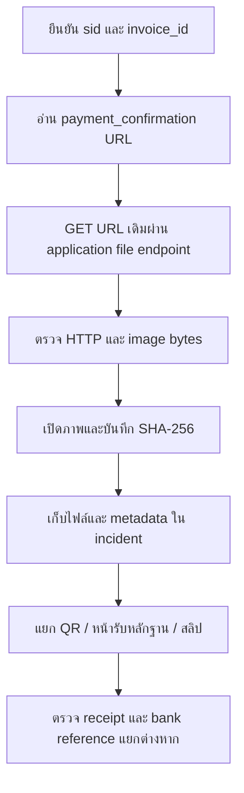

# ตรวจและดาวน์โหลดรูปหลักฐานการชำระเงิน

ขั้นตอนอ่านอย่างเดียวสำหรับ incident ที่ประชาชนเห็น “ยืนยันการชำระเงิน” แต่หลังบ้านยังรอตรวจสอบ ใช้ประกอบ `database-correction.invoice-receipt-incident` ระหว่างตรวจหลักฐาน และใช้เดี่ยว ๆ ได้เมื่อผู้ใช้ขอเพียงสืบค้น/ดาวน์โหลดรูป ไม่ต้องสร้างชุดแก้ฐานข้อมูลหรือดำเนินการ correction เพราะคำขอนี้

## 1. ผูกภาพกับรายการที่ถูกต้อง

ยืนยัน project, registered direct database alias, municipality/system `sid`, utility และ `invoice_id` จาก workspace ของการ์ด/การ์ดแม่ก่อน เลขผู้ใช้น้ำและยอดเงินไม่ใช่ unique key ห้ามใช้ยอดตรงกันเพียงอย่างเดียวแทนการจับคู่ invoice และห้ามนำค่า SU-10772 ด้านล่างไปเป็น default ของการ์ดใหม่

สำหรับ schema น้ำที่ตรวจแล้ว อ่าน `public.water_fee_invoice.payment_confirmation` ซึ่งเก็บ URL ของรูป และ `payment_confirmation_date` ซึ่งเป็นเวลาส่งหลักฐานล่าสุด ตรวจ schema ปัจจุบันก่อนใช้ตัวอย่างนี้; งานขยะ/คำร้องต้อง trace ตารางและคอลัมน์ของงานนั้นใหม่

```sql
SELECT invoice_id, sid, invoice_no, water_id, status,
       payment_confirmation, payment_confirmation_date,
       payment_date, receipt_id, ktb_transaction_id, ref_1, ref_2
FROM public.water_fee_invoice
WHERE sid = '<VERIFIED_SID>'
  AND invoice_id = '<VERIFIED_INVOICE_UUID>'::uuid;
```

แทน placeholder ด้วยค่าที่ตรวจแล้ว บันทึก query เป็นไฟล์ชั่วคราว และใช้ connector ของโครงการผ่าน `.venv` กลาง เช่น:

```bash
.venv/bin/python .agents/skills/sk-database/children/sk-database-connector/scripts/pg_query.py \
  --env '<REGISTERED_DIRECT_DATABASE_ALIAS>' --file '<SCOPED_SELECT_FILE>'
```

ไม่มี `--confirm-write` และไม่ต่อหลาย statement เพื่อเปลี่ยนข้อมูล ใช้ direct target ตามกฎปัจจุบัน ไม่ใช้ Teleport/tunnel รอผล **1 row**; ถ้าไม่มีแถว, scope ไม่ตรง หรือ URL ว่าง ให้บันทึกว่าไม่พบหลักฐานและหยุดขั้นดาวน์โหลด ไม่เดา object key จากชื่อผู้จ่าย/ยอด/เวลา และไม่สร้าง URL ขึ้นใหม่จาก screenshot

เก็บผล SELECT, เวลาอ่าน Asia/Bangkok และ alias ไว้กับ incident โดยไม่เก็บ credentials อย่าตีความ `payment_confirmation_date` ว่าเป็นเวลาธนาคารรับเงินหรือเวลาสร้างไฟล์ครั้งแรก: การส่ง URL เดิมซ้ำสามารถเขียนเวลานี้ใหม่ได้

## 2. ดาวน์โหลด URL ที่บันทึกไว้จริง

ตรวจว่า URL เป็น HTTPS และ host เป็น application/file endpoint ของ environment ที่ลงทะเบียนก่อนเรียก อย่าติดตามลิงก์ภายนอกหรือส่ง credentials ไป host ที่ยังไม่ยืนยัน ใช้ **URL เดิมทั้งเส้น** รวม `key` และ encoding; ไม่มีความจำเป็นต้องขอ S3 access key หรือเรียก upload API

คำสั่งนี้ดาวน์โหลดไป scratch directory ใหม่ทุกครั้ง (รันหลังแทนค่า URL เท่านั้น):

```bash
set -eu
EVIDENCE_URL='<EXACT_PAYMENT_CONFIRMATION_URL_FROM_VERIFIED_ROW>'
EVIDENCE_TMP="$(mktemp -d /tmp/su-payment-evidence.XXXXXX)"
curl --fail --silent --show-error --proto '=https' \
  --connect-timeout 10 --max-time 60 \
  --output "$EVIDENCE_TMP/uploaded-image" \
  --write-out '%{http_code}\n%{content_type}\n%{size_download}\n' \
  "$EVIDENCE_URL" > "$EVIDENCE_TMP/http-result.txt"
cat "$EVIDENCE_TMP/http-result.txt"
file "$EVIDENCE_TMP/uploaded-image"
shasum -a 256 "$EVIDENCE_TMP/uploaded-image"
```

ต้องตรวจ HTTP 200, Content-Type และชนิดไฟล์จาก bytes ให้ตรงกัน เปิดภาพจริงก่อนสรุป ไม่ใช้ชื่อไฟล์หรือ HTTP 200 อย่างเดียว เพราะ response อาจเป็น HTML/JSON error เมื่อได้ redirect, 401/403, 404, timeout หรือชนิดไฟล์ผิด ให้เก็บผลและรายงานข้อจำกัด; ไม่เพิ่ม `-k`, ไม่ข้าม auth และไม่เปลี่ยนเป็น bucket อื่นเพื่อเดาไฟล์ คำสั่งไม่ได้ใช้ `--location` จึงไม่ตาม redirect โดยอัตโนมัติ

## 3. เก็บใน incident พร้อม provenance

เก็บ bytes ต้นฉบับโดยไม่ resize, crop หรือ re-encode และไม่เขียนทับหลักฐานเดิม ใช้ชื่อ retrieval/attempt ใหม่เพื่อแยกการอ่านแต่ละครั้ง เก็บ metadata อย่างน้อย: card, database alias, sid, invoice_id, source field/URL, observed payment_confirmation_date, retrieved_at พร้อม timezone, HTTP status, Content-Type, byte size, SHA-256, image dimensions, relative saved path และผลการเปิดดูภาพ หาก URL มี token ให้เก็บ URL เต็มเฉพาะหลักฐาน private และปิดบัง token ในรายงาน

ใช้ supported CLI writer ของ **parent incident workspace** สำหรับ Jira artifacts; ไม่สร้าง workspace ใหม่และไม่เปลี่ยนกรอบ path ของการ์ดเพื่อให้ได้ extension ที่ต้องการ ใน CLI รุ่นที่ตรวจขณะเขียนคู่มือนี้ `artifacts write` รับเฉพาะ `.md/.txt/.json/.yaml/.tsv/.log` แต่เขียน source bytes ตรง ๆ จึงเก็บ image bytes เป็น `.png.txt` ได้ **เมื่อ file ตรวจแล้วว่าเป็น PNG** พร้อม `media_type: image/png` ใน metadata — suffix `.txt` ไม่ได้แปลงภาพเป็นข้อความ:

```bash
WORK_ITEM='<EXISTING_PARENT_FEATURE_WORK_ITEM>'
RETRIEVAL_ID='<UNIQUE_SAFE_SLUG>'
node bin/sidekicks artifacts write sk-jira-workspace "$WORK_ITEM" \
  "evidence/payment-upload/$RETRIEVAL_ID/image.png.txt" \
  --source "$EVIDENCE_TMP/uploaded-image" --json
node bin/sidekicks artifacts write sk-jira-workspace "$WORK_ITEM" \
  "evidence/payment-upload/$RETRIEVAL_ID/http-result.txt" \
  --source "$EVIDENCE_TMP/http-result.txt" --json
```

สร้าง `metadata.json` ใน scratch แล้วเก็บด้วย writer เดียวกัน ตรวจ SHA-256 ของ **path ที่ CLI คืนจริง** เทียบกับต้นฉบับก่อนลบ scratch หาก reader ต้องการ suffix `.png` ให้ใช้สำเนาใน scratch เพื่อเปิดดู ห้ามรายงานว่าไฟล์เป็น text และห้ามแก้ framework เพื่อหลบข้อจำกัด extension ใน incident นี้ เมื่อ CLI รองรับ binary suffix โดยตรงแล้วให้ใช้ path ที่รองรับแทน

สำหรับ invocation ที่เป็น non-Jira จริง ใช้ `playbook run-base` และ `playbook write-output` ซึ่งรองรับไฟล์ PNG โดยตรงตาม contract เดิม ไม่ใช้เส้นทาง non-Jira แทน parent workspace ของการ์ด ภาพ SU-10772 ที่ถูกเก็บใน knowledge/evidence แล้วให้รักษาตำแหน่งเดิมและอ้างถึงจาก report ไม่ย้ายประวัติย้อนหลัง

## 4. อ่านภาพและแยกชนิดหลักฐาน

| ภาพที่พบ | ยืนยันได้ | ยังยืนยันไม่ได้ |
|---|---|---|
| ใบแจ้งหนี้/QR สำหรับชำระ | มีข้อมูลเรียกเก็บหรือ QR | มีการโอนหรือรับเงินจริงแล้ว |
| หน้ายืนยันหลังอัปโหลดของ SU | UI แสดงผลหลังส่งหลักฐานได้; ต้องประกอบกับ DB/source | ธนาคารรับเงิน/มีใบเสร็จแล้ว |
| สลิปธนาคาร | มีภาพที่อ้างว่าเป็นรายการโอน | ความแท้ การจับคู่ invoice และ settlement จนกว่าจะตรวจอ้างอิง/บัญชี/รายการธนาคาร |

ชื่อและยอดบนหน้า confirm ของ citizen มาจาก invoice; วันที่/เวลามาจาก paymentConfirmationDate; ข้อความวิธีชำระเป็นข้อความคงที่ Footer ระบุว่าเจ้าหน้าที่จะตรวจสอบ 1–2 วันทำการ จึงเป็น **หน้ารับหลักฐานแล้วรอตรวจสอบ** ไม่ใช่ผลยืนยันรับเงินจริง ต้องตรวจ receipt และ KTB/settlement ด้วย reference กับ tenant ตาม schema จริง แยกผล “ไม่พบในฐานที่ตรวจ” จาก “ไม่ได้จ่ายเงิน”

หากพบ HTTP error defect ให้บันทึกเป็นบั๊กแยก การทำซ้ำหน้าสำเร็จจาก error ไม่พิสูจน์ว่าเหตุการณ์ของผู้ใช้เกิดจาก error โดยเฉพาะเมื่อภาพมีชื่อและยอดครบ Plain error ที่ทดสอบทำให้ชื่อว่างและยอด 0.00

## 5. ตัวอย่างที่ตรวจแล้ว: SU-10772 (ไม่ใช่ค่า default)

- Database alias: `smart_utilities_ktb_prod_master`; `sid=S9000`; `invoice_id=9581eb3e-87c1-4238-b558-fce2d169bcd0`; invoice `2570/11000323`; amount `39.59`.
- Stored URL: `https://ktb-su-api.localth.ai/api/file?key=smart-utilities-prod-thailand/paymentConfirmation/SU_61725040-92bd-4ade-80c1-1f3832cfd314_1793684668898`
- GET ที่ตรวจวันที่ 11 พ.ย. 2026: HTTP 200, `image/png`, 234088 bytes, 1290×2796; ดาวน์โหลดซ้ำได้ SHA-256 ตรงกับภาพที่เก็บไว้
- SHA-256: `8340b8acc33f7f454124b1c06ac41a9fbb477dfe38cd22e08966e256464d90a1`.
- ภาพจริงเป็นหน้า QR ใบแจ้งหนี้ SU ยอด 39.59 ไม่ใช่สลิปธนาคาร จึงไม่ใช้ยืนยันว่ามีการจ่ายแล้วหรือไม่จ่าย
- Incident: `projects/su-sk/.knowledge/entries/su-10772-invoice-pending-review-incident.md`.
- Original image: `projects/su-sk/artifacts/runs/su-10772-invoice-pending-review/knowledge/evidence/su10772-payment-confirmation.png`.

## Source trace และ flow



การดาวน์โหลด endpoint จริงอ้างอิง `smart-utilities-api/src/src/v2/services/file/file.controller.ts:9` และ `file.service.ts:21`: GET รับ key, service ใช้ bucket จาก config แล้ว getObject; controller ส่ง Content-Type ของ object และ bytes กลับมา ไม่มีการบันทึกการชำระในเส้นทาง GET นี้ การสร้าง URL หลัง upload อ้างอิง `smart-utilities-citizen-api/src/src/aws-s3/aws-s3.service.ts:16` และการบันทึก invoice อยู่ใน `routes/water-fee-invoice/water-fee-invoice.repository.ts:269` ทั้งหมดเป็น path ภายใน `projects/su-sk/services/`
